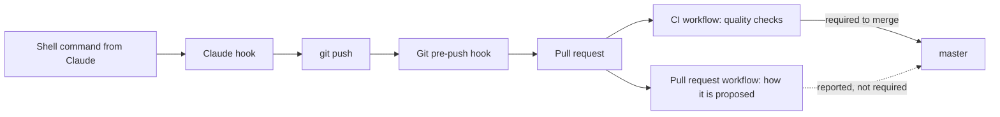

## Overview

claude-plans is meant to be a planning studio for plans made with Claude. So far it is a server and the command
that installs, starts, checks, and stops it. Around the application is the repository: the scripts that set it up
and keep its documents, the safeguards for Claude, and the checks that run on pull requests. This document
describes what exists.
[CONTRIBUTING.md](../../CONTRIBUTING.md) explains how to use it.

The diagram follows a change made with Claude. A change made without Claude skips the first step. The Git hook
exists only in clones where it could be installed.

## Packages

The application's code lives in npm workspaces under `packages/`. So far there are four: `domain`, `backend`,
`cli`, and `logging`. `domain` defines the health report, the color settings, and what a client needs to start,
find, and stop the server, with the path and method of each API. Nothing serves the color settings yet. The
definitions of the data are Zod schemas, so a program can check what it receives and get its TypeScript type from
the same place.

The planned web page will run in a browser, so `domain` must not depend on Node.js. One type check covers its
source without the Node.js types, and another covers its tests, which do use them. The package exports its
TypeScript source and has no build step.

A lint rule in `scripts/boundaries` keeps imports between packages pointing one way. `backend`, `cli`, and
`frontend` may import `domain` but never one another, so that they stay separate programs. Only `backend` and
`cli` may import `logging`. `domain` and `logging` import no other package. A package that the rule does not
know may import none. The rule also rejects a path that leaves its package, which would otherwise get around
the names. It reads the imports in the code, not what runs, so it catches mistakes rather than deliberate
disguises.

## Local data and settings

The data directory is meant to hold everything that the studio saves. `backend` chooses it and handles its
settings file, `settings.yaml`. The default is `.claude-plans/` in the repository, and a different
directory can be named. The code is told where the repository is instead of working it out, so that it cannot
guess its way to the real data. The backend does not stop a caller from choosing the real data. The command does,
as described under [Install](#install).

The settings file may set `port`, `logLevel`, `theme`, and `colorVision`. Each is optional. For the port and the
log level, an option of the `start` command overrides the file, which overrides the default of port 4310 and
level `info`.

A file that is not valid is an error, including one with an unknown name, so that a misspelled setting is not
silently ignored. The backend writes only the color settings. It keeps the other settings and the comments, and
it never writes over a file that it cannot understand. It writes a new file and then renames it over the old one,
so that a failed write cannot leave half of a file. The new file does not keep the old one's permissions, and a
symbolic link in that place is replaced, not followed.

## Database

The database is `database.sqlite` in the data directory. `backend` creates it, migrates it, and reads its schema
version. Only its database program, which `install` runs, migrates it. The program first takes the lock that a
server holds, so that it never changes a database in use. It can also check, changing nothing, that the database
is not newer than the application. [SQLite through node:sqlite](../adrs/0001-sqlite-through-node-sqlite.md) and
[Forward-only migrations](../adrs/0002-forward-only-migrations.md) record the main choices.

The schema version is the number of the last migration that ran. There are no migrations yet, so a new database
holds only the table that tracks them, at version 0. Reading the version opens the database read-only and never
creates one, so that a check of its health cannot set it up. It tells a database that was never set up apart from
one at version 0.

Migrating first checks that the migrations are numbered in order. Two branches that add a migration with the same
number would otherwise both appear to work. Each of its transactions takes the write lock, reads the version, and
refuses a database that is newer than the migrations, so another program cannot slip in between. It opens the
database for writing from the start. After a write is interrupted, SQLite leaves a journal that only such a
connection can use to restore the database, so until then, reading the version fails. A program that finds the
database in use waits up to five seconds. Each migration has its own file in
`database/migrations/`, a directory that may grow past the usual limit of ten files.

Before the database program migrates a database that exists and would be changed, it saves a copy in `backups/`
in the data directory. Nothing is migrated if that fails. If a migration then fails, the program restores the
copy, which also undoes the migrations that ran before the failed one. If it cannot, it says where the copy is.
Either way, the copy stays. Each has its own name, made from the UTC time, the schema version, and random
characters, and no backup writes over another or is deleted later. No backup is made for a new database or one
with nothing to migrate. Deleting the data directory deletes the backups too.

SQLite both writes and restores a copy. It writes one with `VACUUM INTO`, which fails if any part of the
database cannot be read, and the copy gets its name only once it is complete. Only the file's owner may read it,
except on Windows, where the data directory's permissions apply. It restores through its backup
interface, because a file copied over the database could later have the journal of an interrupted write applied
to it. That interface does not wait for a database in use, so the program first waits for the database to be
free. For the same reason, restore a backup by hand with SQLite, such as with the `.restore` command of
`sqlite3`, and stop the server first. If SQLite cannot open the damaged database, first move `database.sqlite`
and any `database.sqlite-journal` aside together. A program that is stopped during a migration cannot restore.
The backup is then still there, and installing again carries on from the migrations that were saved.

## Server

`backend` runs a server for one data directory, using [Fastify](../adrs/0003-fastify-for-the-rest-api.md). Its
server program, in `program/`, reads the settings, makes the logger, and stops the server cleanly when the system
asks. It tells whoever started it whether the server is ready. A server does not start unless the database is at
the schema version that the application has. It checks this after it takes the data directory's lock, and says to
run `install`.

The server reports its health at `/api/health` and says which data directory it uses at `/api/server`, so that a
client can tell it reached the one it meant. The health report is ok only if the database is at the schema
version that the application has. A database that was never set up counts as one that cannot be read. After a
write is interrupted, the report says the same until something opens the database for writing.

There is no login, and any page in a browser can send requests to the local computer. The server therefore listens
only on `127.0.0.1`, and checks every request. Its `Host` header must be `127.0.0.1` or `localhost` with the
server's port, which stops a website whose name was made to point at this computer. An `Origin` header, which
browsers add to say which website is asking, must be the server's own. A development server on another port will
have to allow for this. These checks do not stop other programs on the computer.

While it runs, the server records its port and a random token in `server.json`, which only the file's owner can
read. On Windows, the data directory's permissions apply instead. A request to shut down must give the token. The
record is removed when the server stops, and a record that a crash left is removed by the next server.

A data directory has one server at most, whatever its port. A server holds an unfinished transaction on a small
SQLite database, `server-lock.sqlite`, for as long as it runs. The operating system releases that lock however a
program ends, so a crash cannot block the next start, which a file that merely names a running server could do. A
test on every operating system starts several programs at once.

A port that another program holds is reported, and the server does not choose a different one. Some systems let a
server listen on `127.0.0.1` while another program has the same port on another local address, and `localhost`
could then lead to either one. So before listening, the server tries to connect to the port at both addresses that
`localhost` can mean. The server names its data directory as the disk does, with links followed, so that one
directory has one name however its path was typed. A client has to name its own directory the same way.

## Command line

`cli` is the `claude-plans` command, with `install`, `start`, `stop`, and `health`. It runs either from the
repository, with `npm run claude-plans`, or as a copy that `install` saved. The repository's copy must be given the
full path of a data directory, so that code under development has no default that could lead to the real data. An
installed copy uses the data directory that holds it, unless it is given another.

`start` may not import the backend, so it runs the server program as a separate process and waits for its report.
In the foreground, it then waits for the server to end. A terminal's Ctrl+C reaches both programs, but another
signal may reach only the command, which passes it on. Windows cannot send a signal that a program handles, so
there the command passes nothing on. With `--detached`, the server gets its own process group, so that closing the
terminal does not stop it, and the command returns once the server is ready. Until then, a signal to the command
ends the server program, which Ctrl+C would otherwise not reach. A server program that is not ready in 30 seconds
is ended too.

`stop` and `health` read the port from the data directory's `server.json`. A crash can leave a record that names a
port which another program now holds, so they first ask the server which data directory it uses. Only then does
`stop` send the token. They do not follow redirects, and a program that does not answer is reported as a problem,
not as a stopped server. `stop` waits until the server has removed its record, and succeeds when no server is
running. `health` never starts one. It exits with 0 only if the report is ok, and `--json` prints the report as
the server gave it.

## Install

`install` saves a copy of the application in a data directory, so that the copy in use does not change when the
repository does. Node.js runs the TypeScript as it is, so nothing is compiled. A build is a copy of the root
package files and the packages without their tests. `npm ci` then installs what it needs to run, without
development dependencies or package scripts.

Each build has its own directory in `app/builds/`, and never moves, because npm on Windows links packages by their
full paths. `app/current.json` names the current build, and is replaced by renaming a new file over it. The
launcher in `app/command/` stays in one place and runs whichever build is current. In each build,
`installation.json` records the repository that it came from and whether it may use the real data.

Nothing that is in use changes until the new build has accepted the database. A newer database is refused while
any running server carries on. An unreadable one passes this check, because migrating opens it for writing, which
can recover it. Then `install` stops a server that uses the same data directory, migrates, and makes the new build
current. If the server cannot be stopped, nothing is migrated. A failure before the new build becomes current
removes it and keeps the earlier one. Only a failed migration restores the database. If every migration succeeds
and the new build then cannot be made current, the database stays migrated, which the earlier build may refuse
until another install succeeds. After the new build is current, the install is not undone. A plain install that
then cannot put the command on the path says what is installed, how to run it, and whether a server was stopped.
An earlier build that cannot be deleted is only reported.

The real data is `.claude-plans/` in the main checkout. The command asks Git where that is, even from a worktree,
and does nothing if it cannot tell. It compares paths as the disk names them, ignoring letter case, so that a link
or another spelling does not get past. The repository's copy, and a copy installed in any other directory, refuse
that directory and everything inside it, because they may hold code that nobody has reviewed. A copy does not ask
Git about its own data directory, which `install` already checked, so it keeps working after the checkout that it
came from is removed. A plain install is refused if the path differs from the real one in letter case, because on
some systems that names another directory.

A plain install is one into the real data directory. It works only from the main checkout, on `master`, with no
changes or new files that are not committed, and with no commits that the last fetched `origin/master` lacks. It
then puts `claude-plans` on the user's path with a global npm install of the launcher's package, which works on
every supported system. It refuses if that command already runs another installation, such as one from a second
clone. The first plain install is run from the repository with `npm run install:studio`, the only way for the
repository's copy to reach the real data. Later ones use `claude-plans install`.

These protections stop mistakes. Code that runs under the user's account can still reach the files.

## Logging

`logging` writes to `logs/` in the data directory. It is a separate package because the backend and the command
both need it, and `domain` must run in a browser. The server logs starting, stopping, and failures. It leaves out
its token, and the errors that a faulty request causes, which can quote the request's body. The command logs only
the commands that fail, and never creates a data directory just to log in it.

Each entry is one line of JSON with a UTC time, a level, and a message. The levels are `error`, `warn`, `info`,
and `debug`, and a logger drops entries with more detail than its own level. An entry about an error also has the
stack traces of the error and of those behind it. It leaves out their other properties, which can hold secrets or
the body of a request. A message is written as given, so the code that logs must keep both out of it. An error's
own message is part of its stack trace, so this also applies to errors that quote their input.

Each program writes its own file for each UTC day, such as `backend-2026-03-15.log`. Because the date is in the
name, no file is ever renamed or reopened under a new name, which is hard to do safely when several commands run
at once. Each entry is added to the end of the file with a single write. A test on every operating system has
several programs write to one file at the same time. With its first entry of each day, a program deletes its
files that are older than 14 days, counting today. One that cannot be deleted does not stop the others. A failure
to write or delete a log is reported on the error output, and the program carries on, so that logging never hides
the problem it was meant to record.

## Scripts and the launcher

Every npm script is defined in the root `package.json`. The repository's own tools live in `scripts/`, in one
directory for each job. Most are written in Python, with their tests beside them.

No single command name starts Python on every operating system, so a small TypeScript program,
`scripts/launcher/launch.ts`, starts the Python scripts. Node.js can run it directly, without a build step.
It has three modes:

- `system` finds an installed Python 3.12 or newer, or uses the one named by the `PYTHON` environment variable.
  Setup and the safeguards use this mode, because they have to work before `.venv` exists. They use only
  Python's standard library.
- `python` runs the Python in `.venv`, where the development tools are installed.
- `node` runs the current Node.js.

The last two modes accept a time limit, which the test scripts use to fail a suite that has become too slow. The
limit stops the command that the launcher started, which is not necessarily every process that the command starts.

The Node.js tests are two Vitest projects, so that each has a limit that suits it. Unit tests have 30 seconds.
Integration tests, in files named `*.integration.test.ts`, use a real database, run a server, or start another
program, and have 2 minutes. Each of their tests also has 30 seconds instead of Vitest's usual 5, because
starting another program can take seconds on a busy machine. Each suite saves its results, and a last step merges
them and checks coverage. A suite alone covers only part of the code, so its run does not check coverage.

`npm run setup:python` creates `.venv` and installs `requirements.txt` into it. The file pins every Python
package with a hash, and it is generated from `requirements.in`, which lists only the direct tools. npm uses
`package-lock.json` for the same purpose.

## Safeguards

Two hooks stop mistakes that would be costly to undo. Neither is a security barrier.

Claude Code runs the first one before each shell command, as set in `.claude/settings.json`. `scripts/guard`
reads the command's text and blocks force pushes, pushes to `master`, and pull request merges. Outside a
worktree, it also blocks Git commands that remove or move ignored files, because the real data will be stored in
an ignored directory. Deny rules in the same settings also cover common forms of merging, force pushing, and
pushing to `master`. If the script fails or times out, the command is blocked, so a broken check does not
silently allow everything. Blocking after a timeout needs Claude Code 2.1.295 or newer, because older versions
let the command run. Reading command text cannot see through a deliberate disguise, or catch deletion by other
programs.

The settings also make Claude Code ask before any Bash command whose text names `install:studio` or `--studio`,
which install into the real data from the repository. It asks even about a command that only mentions them. This
does not cover a command run with another tool, such as PowerShell, or the same install typed another way or run
by another program.

The second one is a Git `pre-push` hook that rejects pushes to `master` from a clone, with or without Claude.
`npm install` and `npm ci` copy it into the clone's own hooks directory. It is copied, and not read from the
working tree, so that checking out a branch cannot change which hook runs. A clone with its own `pre-push` hook
or a `core.hooksPath` setting keeps its own setup.

## Checks

`npm run check` runs most quality checks locally. On a pull request, GitHub Actions runs checks in two
workflows. The rules for `master` require every job of the CI workflow to pass before a merge. They do not
require the Pull request workflow, so its failure is reported but does not block a merge.

The CI workflow, in `.github/workflows/ci.yml`, has four kinds of job:

- **Static checks** run the format check, the linters, and the type checks, and confirm that `requirements.txt`
  matches `requirements.in`.
- **Tests** run the test suites on Linux, Windows, and macOS, because the project is meant to run on all three.
  The two Node.js suites together, and the Python suite, each require coverage of at least 80%.
- **Secret scan** reads the whole Git history with gitleaks. The repository is public, so a committed secret is
  exposed even if a later commit removes it.
- **Dependency audit** checks the npm and Python packages for known vulnerabilities. It runs on all three
  systems because the Python audit skips packages that a system would not install.

Besides general-purpose formatters and linters, the lint step runs the repository's own rules.
`scripts/standards` limits the size of files and directories, rejects unclear names, and finds comments that
turn checks off and tests that are skipped. ESLint applies the matching rules to JavaScript and TypeScript, and
jscpd finds copied code. These rules recognize common forms, so review is still needed.

The Pull request workflow runs `scripts/pull_request`, which checks the branch name, title, description, linked
issue, and size of a pull request. It is separate from CI so that editing a title or changing a label can run it
again without repeating the other jobs. It needs only Python's standard library, so it installs nothing.
Dependabot's pull requests are exempt, because Dependabot cannot follow these rules.

Both workflows get read-only access, and they name outside actions by commit, so that a moved tag cannot change
what runs. They run on pull requests only. A branch must be up to date before it merges, so checking `master`
again would test the same content. A workflow also runs the scripts as the pull request has them. A change to a
check is therefore judged by its own version, and needs careful review.

## Documents

`docs/adrs/` holds architecture decision records, and `docs/designs/` holds design documents such as this one.
`scripts/documents` creates numbered documents and builds [the index](../README.md) from the title and
description at the top of each one. The index is generated so that it cannot drift from the documents. It is
committed so that it can be read on GitHub, and the lint step fails when it is out of date.

The index is a table, and the formatter and Markdown lint check it like any other file. For that reason, titles
and descriptions must be plain text that neither tool would rewrite or reject.
