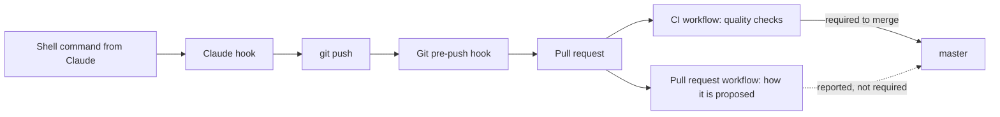

## Overview

claude-plans is meant to be a planning studio for plans made with Claude. The application cannot run yet. Its
packages hold the models that its parts will share, and the first parts of the backend. Around them is the
repository: the scripts that set it up and keep its documents, the safeguards for Claude, and the checks that run
on pull requests. This document describes what exists. [CONTRIBUTING.md](../../CONTRIBUTING.md) explains how to
use it.

The diagram follows a change made with Claude. A change made without Claude skips the first step. The Git hook
exists only in clones where it could be installed.

## Packages

The application's code lives in npm workspaces under `packages/`. So far there are two, `domain` and `backend`.
`domain` defines the health report and the color settings, with the path and method of the API for each. Nothing
serves those APIs yet. The definitions are Zod schemas, so a program can check the data it receives and get its
TypeScript type from the same place.

The planned web page will run in a browser, so `domain` must not depend on Node.js. One type check covers its
source without the Node.js types, and another covers its tests, which do use them. The package exports its
TypeScript source and has no build step.

A lint rule in `scripts/boundaries` keeps imports between packages pointing one way. `backend`, `cli`, and
`frontend` may import `domain` but never one another, so that they stay separate programs. Only `backend` and
`cli` may import `logging`. `domain` and `logging` import no other package. A package that the rule does not
know may import none. The rule also rejects a path that leaves its package, which would otherwise get around
the names. It reads the imports in the code, not what runs, so it catches mistakes rather than deliberate
disguises.

## Local data and settings

The data directory is meant to hold everything that the studio saves. So far `backend` only chooses it and
handles its settings file, `settings.yaml`. The default is `.claude-plans/` in the repository, and a different
directory can be named. The code is told where the repository is instead of working it out, so that it cannot
guess its way to the real data. Nothing yet stops a caller from choosing the real data.

The settings file may set `port`, `logLevel`, `theme`, and `colorVision`. Each is optional. For the port and the
log level, a command option overrides the file, which overrides the default of port 4310 and level `info`. There
are no commands yet to give those options.

A file that is not valid is an error, including one with an unknown name, so that a misspelled setting is not
silently ignored. The backend writes only the color settings. It keeps the other settings and the comments, and
it never writes over a file that it cannot understand. It writes a new file and then renames it over the old one,
so that a failed write cannot leave half of a file. The new file does not keep the old one's permissions, and a
symbolic link in that place is replaced, not followed.

## Scripts and the launcher

Every npm script is defined in the root `package.json`. The repository's own tools live in `scripts/`, in one
directory for each job. Most are written in Python, with their tests beside them.

No single command name starts Python on every operating system, so a small TypeScript program,
`scripts/launcher/launch.ts`, starts the Python scripts. Node.js can run it directly, without a build step.
It has three modes:

- `system` finds an installed Python 3.12 or newer, or uses the one named by the `PYTHON` environment variable.
  Setup and the safeguards use this mode, because they have to work before `.venv` exists. They use only
  Python's standard library.
- `python` runs the Python in `.venv`, where the development tools are installed.
- `node` runs the current Node.js.

The last two modes accept a time limit, which the test scripts use to fail a suite that has become too slow. The
limit stops the command that the launcher started, which is not necessarily every process that the command starts.

`npm run setup:python` creates `.venv` and installs `requirements.txt` into it. The file pins every Python
package with a hash, and it is generated from `requirements.in`, which lists only the direct tools. npm uses
`package-lock.json` for the same purpose.

## Safeguards

Two hooks stop mistakes that would be costly to undo. Neither is a security barrier.

Claude Code runs the first one before each shell command, as set in `.claude/settings.json`. `scripts/guard`
reads the command's text and blocks force pushes, pushes to `master`, and pull request merges. Outside a
worktree, it also blocks Git commands that remove or move ignored files, because the real data will be stored in
an ignored directory. Deny rules in the same settings also cover common forms of merging, force pushing, and
pushing to `master`. If the script fails or times out, the command is blocked, so a broken check does not
silently allow everything. Blocking after a timeout needs Claude Code 2.1.295 or newer, because older versions
let the command run. Reading command text cannot see through a deliberate disguise, or catch deletion by other
programs.

The second one is a Git `pre-push` hook that rejects pushes to `master` from a clone, with or without Claude.
`npm install` and `npm ci` copy it into the clone's own hooks directory. It is copied, and not read from the
working tree, so that checking out a branch cannot change which hook runs. A clone with its own `pre-push` hook
or a `core.hooksPath` setting keeps its own setup.

## Checks

`npm run check` runs most quality checks locally. On a pull request, GitHub Actions runs checks in two
workflows. The rules for `master` require every job of the CI workflow to pass before a merge. They do not
require the Pull request workflow, so its failure is reported but does not block a merge.

The CI workflow, in `.github/workflows/ci.yml`, has four kinds of job:

- **Static checks** run the format check, the linters, and the type checks, and confirm that `requirements.txt`
  matches `requirements.in`.
- **Tests** run both test suites on Linux, Windows, and macOS, because the project is meant to run on all three.
  Each suite requires coverage of at least 80%.
- **Secret scan** reads the whole Git history with gitleaks. The repository is public, so a committed secret is
  exposed even if a later commit removes it.
- **Dependency audit** checks the npm and Python packages for known vulnerabilities. It runs on all three
  systems because the Python audit skips packages that a system would not install.

Besides general-purpose formatters and linters, the lint step runs the repository's own rules.
`scripts/standards` limits the size of files and directories, rejects unclear names, and finds comments that
turn checks off and tests that are skipped. ESLint applies the matching rules to JavaScript and TypeScript, and
jscpd finds copied code. These rules recognize common forms, so review is still needed.

The Pull request workflow runs `scripts/pull_request`, which checks the branch name, title, description, linked
issue, and size of a pull request. It is separate from CI so that editing a title or changing a label can run it
again without repeating the other jobs. It needs only Python's standard library, so it installs nothing.
Dependabot's pull requests are exempt, because Dependabot cannot follow these rules.

Both workflows get read-only access, and they name outside actions by commit, so that a moved tag cannot change
what runs. They run on pull requests only. A branch must be up to date before it merges, so checking `master`
again would test the same content. A workflow also runs the scripts as the pull request has them. A change to a
check is therefore judged by its own version, and needs careful review.

## Documents

`docs/adrs/` holds architecture decision records, and `docs/designs/` holds design documents such as this one.
`scripts/documents` creates numbered documents and builds [the index](../README.md) from the title and
description at the top of each one. The index is generated so that it cannot drift from the documents. It is
committed so that it can be read on GitHub, and the lint step fails when it is out of date.

The index is a table, and the formatter and Markdown lint check it like any other file. For that reason, titles
and descriptions must be plain text that neither tool would rewrite or reject.
