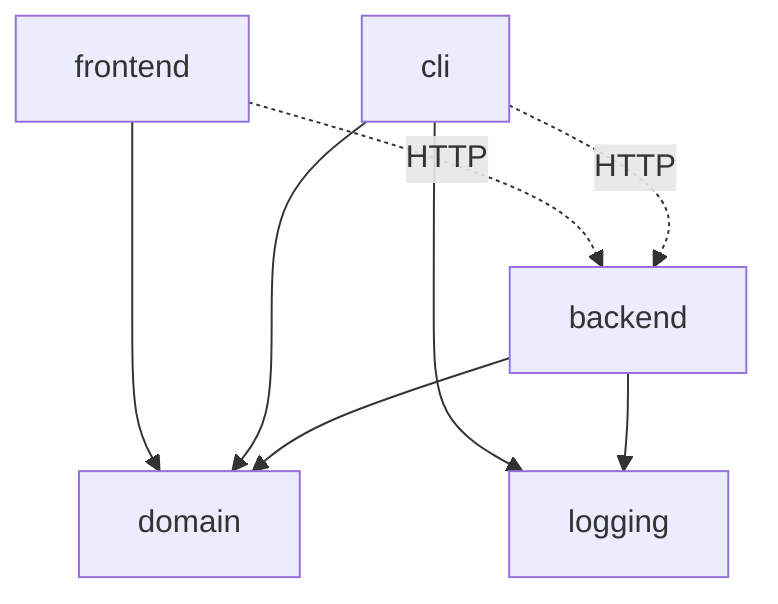

# Architecture requirements

This file covers how the bootstrap is built. See [SPEC.md](SPEC.md) for scope and standards.

## Platform and packages

The studio runs locally on macOS, Linux, Windows, and Windows Subsystem for Linux (WSL).
It uses npm workspaces, Node.js 24, strict TypeScript, and ES modules.

| Package             | Responsibility                                                           |
| ------------------- | ------------------------------------------------------------------------ |
| `packages/domain`   | Shared models and API contracts, validated with Zod                      |
| `packages/backend`  | Fastify REST API, database, settings, and delivery of the built web page |
| `packages/cli`      | The `claude-plans` command                                               |
| `packages/logging`  | Logging for the backend and the CLI                                      |
| `packages/frontend` | React and TypeScript web page, built with Vite, plus Storybook           |

## Module boundaries

Solid arrows are allowed imports, and dotted arrows are runtime calls.
`backend`, `cli`, and `frontend` may import `domain`, but never one another. Only `backend` and `cli`
may import `logging`. Neither `domain` nor `logging` imports those three. Automated checks enforce these directions.

The CLI reads data only through the backend API. For `install` and `start`,
it runs the backend as a separate program without importing its source code.

## Server lifecycle

- `start` runs in the foreground unless `--detached` is given.
- `stop` asks the server to shut down through a protected local API.
  This behaves the same on every supported operating system.
- `npm run dev` starts the backend and Vite for development. The built application is served on one port.
- The server accepts connections only from the local computer. The default port is 4310. The YAML settings file
  in the data directory overrides it, and a command option overrides both.
- Development picks a free port. If the real server's port is taken, it reports an error instead of switching.
- As a proposed safeguard, `start` refuses when a server is already running on the same data directory,
  whatever its port, even if two starts happen at once. A record left by a crashed server does not block it.
- There is no login. The server checks each request's `Host` and `Origin` headers so other websites cannot use its APIs.

## Local data

The data directory holds the SQLite database, a YAML settings file, and logs. The real one is the Git-ignored
`.claude-plans/` directory in the maintainer's own copy.

A plain `install` also saves the built application there. The `claude-plans` command on the user's path always runs
that saved copy, whichever branch or directory is open. It uses the real data unless an option names another
data directory. Switching branches or building new code does not change the saved copy.

A plain `install` works only from the maintainer's own copy, on `master`, with no local code changes.
Otherwise, it changes nothing and explains how to use a separate data directory.

`install` and `start` accept a different data directory, and `start` also accepts a different port.
An install with a different data directory builds apart from the saved application.
Development scripts never use the real data by default.

These protections greatly lower the risk of accidents to the data that [SPEC.md](SPEC.md) protects.
They cannot stop other code running under the user's account from reaching the files.

The following details are proposed:

- The options are `--data-directory <path>` and `--port <number>`.
- `npm run dev` has its own data directory and port, and Vite connects to that backend.
- A plain `install` also refuses when local `master` has commits that the remote `master` does not.
- Naming the real data directory in an option does not bypass these protections, and development scripts reject it.
- `stop` and `health` also accept `--data-directory`, and find the port that the running server recorded there.
- Before acting, they confirm that the server they reach uses the expected data directory.

Besides any port and log level overrides, the settings file holds `theme` (`system`, `light`, `dark`)
and `colorVision` (`default`, `protan`, `deutan`, `tritan`).
Only the backend writes it, keeping any overrides, and it exposes APIs to read and update it.

To prevent a color flash, the backend adds the saved choices to the HTML before sending it.
During development, Vite does the same with values from the backend. With `system`,
CSS follows the operating system immediately.

Styling uses CSS Modules with shared color variables, without a component library.

## Logging

The studio writes logs to `logs/` in the data directory, by default `.claude-plans/logs/`. Log files rotate
by date rather than by size. The default log level is `info`. The YAML settings file overrides it,
and `start --log-level` overrides both. Web page errors stay in the browser console during the bootstrap.

The following details are proposed defaults:

- The backend and the CLI write separate files, so two programs never rotate the same file.
- Each entry is one line of JSON with a UTC time, a level, and a message. Errors include their stack traces.
- The levels are `error`, `warn`, `info`, and `debug`.
- A new file starts each day, based on the UTC date, which appears in the file name.
- Each program keeps 14 days of log files and deletes older ones.
- A detached server logs to the same files as a foreground server, including failures during startup.
- Logs never contain secrets or the bodies of requests and responses.

## Install and outdated builds

`claude-plans install` builds the application. If a server is running, `install` stops it first,
and its closing message says to start the server again.

If the database is newer than the application supports, `install` explains the problem and changes nothing.
A running server stays running.

If the version in the root `package.json` on local `master` no longer matches the saved build,
`claude-plans` commands that depend on it refuse to run. They say to run `claude-plans install`.
Work on another branch does not trigger this check.

The check compares only versions. It does not detect an outdated build after a change that keeps the same version,
such as a Dependabot update. This is accepted.

The following details are proposed:

- `install` stops only the server that uses the same data directory.
- If that server cannot be stopped, `install` fails without changing anything.
- The build records its version. Any difference counts, whether the source is newer or older.
- This check never blocks `install` or `stop`. Its message also says that a plain `install` needs the user's
  own copy on an unchanged `master`.
- `install` replaces the saved application only after the backup and every migration succeed.
- A new backup never overwrites an earlier one.
- The CLI also checks a running server's version. If it differs, the CLI says to stop the server, install, and start it.

## Database and migrations

- Use SQLite through Node's built-in `node:sqlite` module, with plain SQL and no object-relational mapper.
- Start with only the migration tracking table.
- Track the schema version. Numbered migrations move both schema and data forward, each in a transaction.
- There are no down migrations.
- Before `install` migrates an existing database, it backs the database up. As proposed, a failed backup stops
  the migration.
- Backups go in `backups/` in the data directory, so deleting that directory also deletes them.
- If any migration fails, `install` restores the backup it just made, so the previous saved application
  still works. If the restore also fails, `install` says where the backup is.
- Only `claude-plans install` runs migrations.
- `start` refuses a database that is behind or ahead of the application's schema version.

## Quality tooling

| Concern                        | Tool or check                                     |
| ------------------------------ | ------------------------------------------------- |
| TypeScript lint and format     | ESLint with strict type-aware rules, and Prettier |
| Markdown lint and format       | markdownlint and Prettier                         |
| Python lint, format, and types | Ruff and a strict type checker                    |
| Unit and integration tests     | Vitest                                            |
| Component tests                | Storybook with Vitest                             |
| End-to-end tests               | Playwright with Chromium                          |

Automated checks also cover TSDoc comments, abbreviations, import boundaries, duplicated code,
complexity, file and directory limits, grab-bag names, and suppression comments.
They also reject tests marked to be skipped or run alone.
TDD is a repository rule, because CI cannot prove that a test was written first.

## Continuous integration

| Checks                         | Operating systems         |
| ------------------------------ | ------------------------- |
| Static checks                  | Linux                     |
| Unit and integration tests     | Linux, Windows, and macOS |
| Component and end-to-end tests | Linux with Chromium       |

CI caches dependencies, cancels outdated runs, scans for secrets, and audits dependencies.
Linux jobs do not fully test WSL. Secret scanning also runs locally.

## Repository protection

A ruleset on `master` blocks deletion and force pushes, requires a PR and code owner review,
and allows only squash merges. The bootstrap adds a `CODEOWNERS` file naming the maintainer.
The maintainer has tested that this ruleset does not block merging their own PRs.

The ruleset is intentionally simple and will be revisited. Once CI exists, it should require those checks
and require branches to be up to date with `master`.
