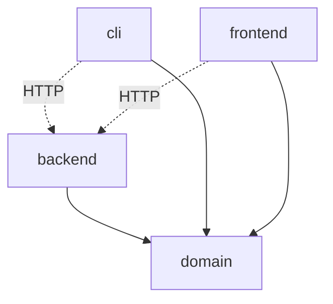

# Architecture requirements

This file covers how the bootstrap is built. See [SPEC.md](SPEC.md) for scope and standards.

## Platform and packages

The studio runs locally on macOS, Linux, Windows, and Windows Subsystem for Linux (WSL).
It uses npm workspaces, Node.js 24, strict TypeScript, and ES modules.

| Package | Responsibility |
|---|---|
| `packages/domain` | Shared models and API contracts, validated with Zod |
| `packages/backend` | Fastify REST API, database, settings, and delivery of the built web page |
| `packages/cli` | The `claude-plans` command |
| `packages/frontend` | React and TypeScript web page, built with Vite, plus Storybook |

## Module boundaries

Solid arrows are allowed imports, and dotted arrows are runtime calls.
`backend`, `cli`, and `frontend` may import `domain`, but never one another.
`domain` imports none of them. Automated checks enforce these directions.

The CLI reads data only through the backend API. For `install` and `start`,
it runs the backend as a separate program without importing its source code.

## Server lifecycle

- `start` runs in the foreground unless `--detached` is given.
- `stop` asks the server to shut down through a protected local API.
  This behaves the same on every supported operating system.
- `npm run dev` starts the backend and Vite for development. The built application is served on one port.
- The server accepts connections only from the local computer. The default port, 4310, can be changed.
- There is no login. The server checks request origins so other websites cannot use its APIs.

## Local data

All local data lives in the Git-ignored `.claude-plans/` directory in the repository:
the SQLite database and a YAML settings file. Each Git worktree has its own directory,
so work in one worktree does not touch another's data.

The settings file holds `theme` (`system`, `light`, `dark`) and `colorVision`
(`default`, `protan`, `deutan`, `tritan`). Only the backend writes it, and it exposes APIs to read and update it.

To prevent a color flash, the backend adds the saved choices to the HTML before sending it.
During development, Vite does the same with values from the backend. With `system`,
CSS follows the operating system immediately.

Styling uses CSS Modules with shared color variables, without a component library.

## Database and migrations

- Use SQLite through Node's built-in `node:sqlite` module, with plain SQL and no object-relational mapper.
- Start with only the migration tracking table.
- Track the schema version. Numbered migrations move both schema and data forward, each in a transaction.
- There are no down migrations and no backups for now.
- Only `claude-plans install` runs migrations.
- `start` refuses a database that is behind or ahead of the application's schema version.

## Quality tooling

| Concern | Tool or check |
|---|---|
| TypeScript lint and format | ESLint with strict type-aware rules, and Prettier |
| Markdown lint and format | markdownlint and Prettier |
| Python lint, format, and types | Ruff and a strict type checker |
| Unit and integration tests | Vitest |
| Component tests | Storybook with Vitest |
| End-to-end tests | Playwright with Chromium |

Automated checks also cover TSDoc comments, abbreviations, import boundaries, duplicated code,
complexity, file and directory limits, grab-bag names, and suppression comments.
They also reject tests marked to be skipped or run alone.
TDD is a repository rule, because CI cannot prove that a test was written first.

## Continuous integration

| Checks | Operating systems |
|---|---|
| Static checks | Linux |
| Unit and integration tests | Linux, Windows, and macOS |
| Component and end-to-end tests | Linux with Chromium |

CI caches dependencies, cancels outdated runs, scans for secrets, and audits dependencies.
Linux jobs do not fully test WSL. Secret scanning also runs locally.

## Repository protection

A ruleset on `master` blocks deletion and force pushes, requires a PR and code owner review,
and allows only squash merges. A `CODEOWNERS` file names the maintainer.
The maintainer has tested that this ruleset does not block merging their own PRs.

The ruleset is intentionally simple and will be revisited. Once CI exists, it should require those checks
and require branches to be up to date with `master`.
